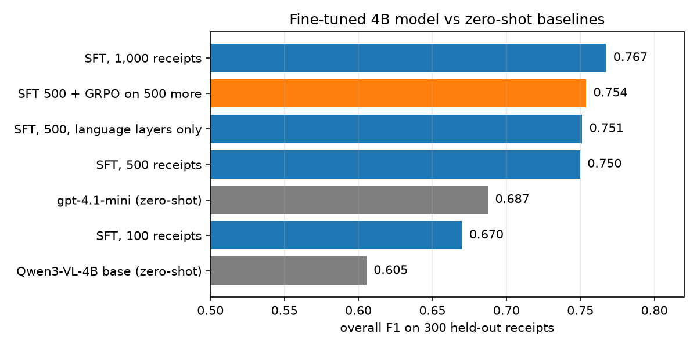
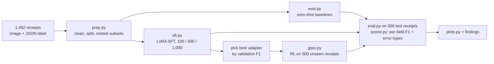
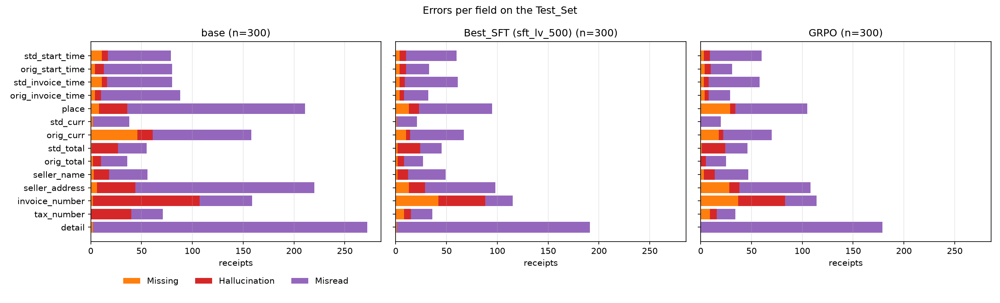
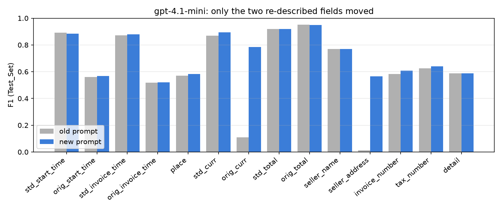
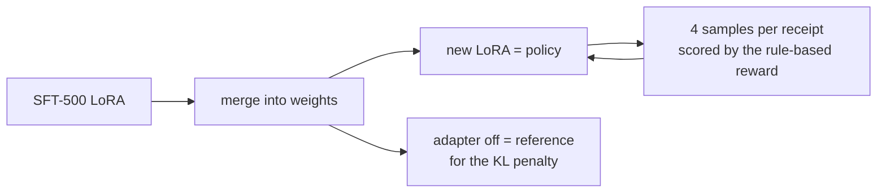
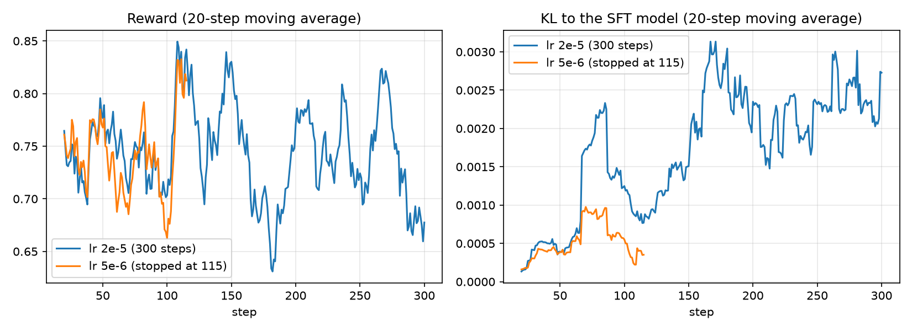

# Receipt extraction: fine-tuning a 4B vision model to beat gpt-4.1-mini

Fine-tuning **Qwen3-VL-4B** with LoRA on **500 labelled receipts** turns an image of a receipt into structured JSON more accurately than **gpt-4.1-mini**: overall F1 **0.750 vs 0.687** on 300 held-out receipts. With 1,000 receipts it reaches **0.767**. Each SFT run takes 4–25 minutes on one RTX 4090, and the whole project (every training run, eval and failed attempt) cost **$7.22**.



**Highlights**

- **Small data wins.** 500 examples are enough to beat a frontier API model zero-shot. Most of the gain comes in the first few hundred examples.
- **Training the vision encoder is unnecessary here.** LoRA on the language layers only scores the same (0.751 vs 0.750), with 16% fewer trainable parameters.
- **GRPO after SFT didn't pay off, and the run shows why.** Using 500 extra receipts as RL prompts gave +0.004 F1; using them as SFT data gave +0.017. The reward taught the model to leave uncertain fields blank, a gap between the reward and the metric.
- **The details mattered.** A hidden 512 px downscale in the training collator, a GRPO reference-model bug, and a vague prompt line that zeroed two fields would each have quietly skewed the results. All three were caught and fixed.

## The task

Each receipt image must become one JSON object with 14 fields: dates (as printed and standardised), place, currency, totals, seller name and address, invoice and tax numbers, and the list of line items.

A real label from the test set:

```json
{
  "std_start_time": "2016-08-23", "orig_start_time": "23-08-16",
  "std_invoice_time": "2016-08-23", "orig_invoice_time": "23-08-16",
  "place": "Singapore", "std_curr": "SGD", "orig_curr": ["Singapore"],
  "std_total": "50.40", "orig_total": "50.40",
  "seller_name": ["FAMILY RESTAURANT"], "seller_address": ["Singapore"],
  "invoice_number": "00045839", "tax_number": "",
  "detail": [
    {"content": "HP-Boodae Jigae", "amount": "42.80", "ifTax": false},
    {"content": "10% Svc Charge", "amount": "4.28", "ifTax": true},
    {"content": "7% GST", "amount": "3.30", "ifTax": true}
  ]
}
```

Scoring is strict field-level F1 against the human labels: exact match after normalisation, fuzzy text match (≥ 0.85) for names and items, ±0.01 for amounts. Every field outcome is classed as **correct**, **missing**, **hallucination** (a value where the label is empty) or **misread** (a wrong value). All models get the same prompt, the same images (capped at 1 megapixel) and the same scorer.

**Data:** 1,492 receipts from the PurchaseTicket subset of [ReceiptBench](https://github.com/wwwT0ri/ReceiptBench) (MIT license), split into a fixed 300-receipt test set, a 50-receipt validation set and nested training subsets of 100, 500 and 1,000. Results are not compared with the ReceiptBench paper's numbers, which use a different setup.

## How it works



| Piece | Choice |
|---|---|
| Base model | `Qwen3-VL-4B-Instruct`, bf16 (no quantisation) |
| Fine-tuning | [Unsloth](https://github.com/unslothai/unsloth) + TRL, LoRA r 16 on attention and MLP, 3 epochs, lr 2e-4 |
| RL | TRL GRPO, 4 samples per receipt, rule-based reward built from the scorer |
| Baseline API | `gpt-4.1-mini`, same prompt |
| Hardware | one RunPod RTX 4090 (24 GB); peak training memory 10 GB |
| Inference | HF `generate`, greedy, batches of 8 receipts |

The model is never selected on test results. The adapter GRPO builds on was chosen by validation F1 only.

## Results

### Data-efficiency curve


| Model | Test F1 | Precision | Recall | Parse failures | Training time |
|---|---|---|---|---|---|
| Qwen3-VL-4B base, zero-shot | 0.605 | 0.563 | 0.654 | 0 | – |
| gpt-4.1-mini, zero-shot | 0.687 | 0.655 | 0.724 | 0 | – |
| SFT, 100 receipts | 0.670 | 0.672 | 0.668 | 8 | 3.5 min |
| SFT, 500 receipts | 0.750 | 0.744 | 0.755 | 1 | 12.7 min |
| **SFT, 1,000 receipts** | **0.767** | **0.769** | **0.765** | 1 | 24.6 min |
| SFT, 500, language layers only | 0.751 | 0.747 | 0.755 | 2 | 10.9 min |
| SFT 500 + GRPO on 500 more | 0.754 | 0.751 | 0.757 | 0 | +85 min |

The curve flattens fast. Each extra 100 examples was worth about +0.020 F1 between 100 and 500, but only +0.003 between 500 and 1,000.

### Per field


| Field | Base | gpt-4.1-mini | SFT 500 | SFT 1,000 | GRPO |
|---|---|---|---|---|---|
| place | 0.246 | 0.582 | 0.658 | **0.668** | 0.624 |
| seller_address | 0.227 | 0.565 | 0.654 | **0.664** | 0.615 |
| orig_curr | 0.505 | 0.785 | 0.778 | **0.806** | 0.778 |
| detail (line items) | 0.525 | 0.587 | 0.645 | **0.678** | 0.658 |
| orig_start_time | 0.727 | 0.569 | 0.896 | 0.892 | **0.903** |
| orig_invoice_time | 0.693 | 0.522 | 0.896 | 0.892 | **0.907** |
| std_curr | 0.876 | 0.894 | 0.932 | 0.925 | **0.933** |
| seller_name | 0.828 | 0.768 | 0.842 | 0.850 | **0.853** |
| std_total | 0.853 | **0.918** | 0.882 | 0.911 | 0.879 |
| orig_total | 0.893 | **0.948** | 0.921 | 0.926 | 0.923 |
| std_start_time | 0.733 | **0.885** | 0.795 | 0.810 | 0.793 |
| std_invoice_time | 0.728 | **0.880** | 0.790 | 0.801 | 0.799 |
| tax_number | 0.407 | **0.641** | 0.565 | 0.613 | 0.600 |
| invoice_number | 0.515 | **0.606** | 0.577 | 0.551 | 0.575 |
| **overall** | 0.605 | 0.687 | 0.750 | **0.767** | 0.754 |

The fine-tuned model leads on 9 of 14 fields. gpt-4.1-mini still leads on converting dates to `YYYY-MM-DD`, totals and the two ID fields, which take reasoning and reading of small print rather than knowing the dataset's conventions.

### Where the errors are



Fine-tuning cut hallucinations from 301 to 119 and misreads from 1,200 to 632 (SFT 1,000). What remains is mostly misreads: small digits in invoice numbers, line-item text, and day/month order on dates like `8/01/16`.

## What I learned

### 1. Fine-tuning mostly teaches the labels' conventions

The base model reads receipts well. It loses because the labels follow habits the field names don't reveal:
- `seller_address` is a `Country-City` location, not the street address.
- Printed dates never include the time.
- Summary lines (Subtotal, Total, Change) are left out of the item list.
- Many receipts have an empty invoice number even though one is printed.

SFT learns these from a few hundred examples. For example, `place` went from 0.25 to 0.66, and overall precision rose from 0.56 to 0.77 mostly because the model stopped listing summary lines. That's why the curve flattens: once the conventions are learned, the remaining errors are harder reading and reasoning.

### 2. The prompt has to describe the labels, not the concept

Rewording two prompt lines (what `orig_curr` and `seller_address` contain) raised gpt-4.1-mini from **0.625 to 0.687** overall, and those two fields from near zero to 0.79 and 0.57. Every model uses the corrected prompt, so the comparison stays fair. Without that check, the API baseline would have looked 0.06 weaker than it really is.



### 3. The vision encoder doesn't need LoRA for receipts


Language-only LoRA ties language+vision LoRA (0.751 vs 0.750). The two models agree on 94% of field outcomes, and the fields that depend on reading small print don't improve with vision LoRA. The encoder already reads printed receipts well; the errors are in what the model decides to write. Language-only is cheaper to train, and the adapter is easier to serve (vLLM supports LoRA on the language layers, not on the vision tower).

### 4. GRPO on top of SFT: a clear negative result

GRPO started from the SFT-500 model and trained on the 500 receipts it had never seen. So it used the same 1,000 labels as SFT-1,000, which makes the question fair: **are 500 extra labels worth more as RL prompts or as SFT examples?**





- **Result:** test F1 0.750 → 0.754 and validation 0.751 → 0.746, both noise. SFT on the same receipts gave 0.767 in less than a third of the time.
- **The reward taught a shortcut.** It penalised a hallucinated field (−0.5) but not a missing one. GRPO learned to leave `place` and `seller_address` blank when unsure: 78 blank receipts instead of 56. Hallucinations on those fields fell from 26 to 15, but F1 dropped by 0.04 on each, because F1 counts a blank as an error too. A reward based directly on the metric (per-receipt F1) would remove the incentive.
- **Little signal to learn from.** On a third of the steps, all 4 samples scored within 0.05 of each other. Most remaining errors are misreads, and sampling rarely produces the correct reading of a digit the model can't see, so there is no better answer to reinforce.
- **A trap worth knowing:** training GRPO directly on the SFT LoRA makes TRL use the *base* model as the KL reference (it switches the adapter off). The penalty then pulls the policy back toward the untuned model: KL was 0.24 before any update. Merging the SFT adapter first, then training a fresh LoRA, fixes it.
- **Learning rate:** 5e-6, a common full-fine-tuning value, barely moved the LoRA policy (KL 0.0005 after 115 steps). 2e-5 moved it about 3× more, but still not toward better answers.

### 5. Small models loop when trained on too little data

The 100-example adapter failed to produce valid JSON on 8 of 300 receipts, mostly by repeating a digit or an item line until the token limit. That cost about 0.011 F1. At 500 and 1,000 examples, only one receipt still fails: one with many identical drink lines, where repeating the line is partly correct. More varied data fixes it. A decode-time repetition penalty would also damage legitimate repeated item lines.

### 6. Engineering details that changed the numbers

- **Hidden downscaling:** Unsloth's vision collator shrank every training image to 512 px wide by default, while eval used up to 1 MP. Setting `resize="max"` makes training and eval see the same images. Without it, the model would have trained on blurrier receipts with no error message.
- **Batched inference:** generating 8 receipts per call made local eval **4.6× faster** (22.4 s → 4.9 s per receipt), with per-field F1 within 0.017 of batch 1. At batch 1, the evals alone would have cost more than all the training.
- **Cost per receipt:** the fine-tuned model costs $0.0011 per receipt on a $0.89/h GPU, about 1.1× gpt-4.1-mini ($0.00097), with 0.08 higher F1. 
- **Validation is small:** with 50 validation receipts, model selection twice ranked adapters differently from the 300-receipt test set. The rule (select on validation, report on test) stayed, and the disagreement is reported rather than hidden.

## Limits of the labels

About 21% of field outcomes defeat both zero-shot models, largely because of label noise:
- US locations are written `USA` 413 times and `United States` 208 times, with no visible rule.
- 7.6% of receipts have a `0.00` standardised total.
- On 15% of receipts every line item is marked as tax (tax-inclusive prices).

The scorer was deliberately not loosened to forgive any of this, so every model is judged against the same labels.

## Repository

| Path | What it is |
|---|---|
| `config.py` | all settings: prompt, fields, image cap, model, prices |
| `prep.py` | label cleaning, train/val/test split, nested subsets → `data/` |
| `scorer.py` | JSON parsing, per-field matching, F1, error types, GRPO reward |
| `eval.py` | batched evaluation of base, API or adapter models → `results/` |
| `sft.py` | LoRA SFT (`--size`, `--layers`) → `runs/sft_*` |
| `grpo.py` | merges the best SFT adapter and runs GRPO → `runs/grpo` |
| `plots.py` | all charts → `plots/` |
| `results/` | predictions, per-field scores and error lists for every model |
| `findings/` | detailed write-ups of each experiment |

## Reproduce

```bash
pip install -r requirements-local.txt       # local: prep, API eval, scoring, plots
python prep.py                              # needs the ReceiptBench PurchaseTicket data in dataset/

# on a CUDA GPU (24 GB)
bash setup_runpod.sh                        # installs requirements-pod.txt
python eval.py --model base --split test
python eval.py --model api  --split test    # needs OPENAI_API_KEY
python sft.py --size 500                    # also 100, 1000; --layers language-only for the ablation
python eval.py --model runs/sft_lv_500/adapter --split test
python grpo.py
python eval.py --model runs/grpo/selected.txt --split test
python plots.py
```

Adapters aren't in the repo (about 150 MB each). Everything else needed to check the numbers (predictions, scores, training logs and settings) is under `results/` and `runs/`.

## Credits

Receipts and labels: [ReceiptBench](https://github.com/wwwT0ri/ReceiptBench) (MIT license). Model: [Qwen3-VL-4B-Instruct](https://huggingface.co/Qwen/Qwen3-VL-4B-Instruct). Training: [Unsloth](https://github.com/unslothai/unsloth) and [TRL](https://github.com/huggingface/trl).
