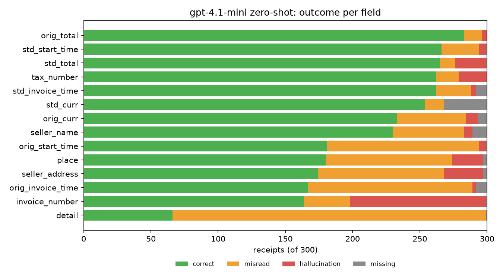

# Frontier zero-shot baseline: gpt-4.1-mini

## Summary

gpt-4.1-mini scores **overall F1 0.687** (precision 0.655, recall 0.724) on the 300 Test_Set receipts, at about $0.001 and 4 s per receipt, with no parse failures. It reads receipts well: totals, standardised dates and currency codes all score around 0.9. Most of its lost score comes from the dataset's annotation habits, not from misreading. Forgiving just three of those habits (time appended to orig dates, and country spelling in `place`) would lift overall F1 to 0.737. That makes this a strong baseline for reading ability, and a beatable one for following the dataset's rules, which is exactly what a fine-tuned model can learn.

Outcomes per field per receipt: **correct**, **misread** (both sides have a value and they don't match), **hallucination** (the label is empty but the model gave a value) and **missing** (the label has a value but the model gave none).

## Per-field results

| Field | F1 | Main failure | Cause |
|---|---|---|---|
| orig_total | 0.948 | – | reads well |
| std_total | 0.918 | 23 hallucinations | all 23 have a `0.00` label while the receipt shows a total (label noise) |
| std_curr | 0.894 | 32 missing | leaves the code blank instead of inferring it, mostly for USD |
| std_start_time | 0.885 | 28 misreads | 6 are day/month swaps on ambiguous dates (`2024-09-06` vs `2024-06-09`) |
| std_invoice_time | 0.880 | 26 misreads | same as above |
| orig_curr | 0.785 | 51 misreads | symbol/city combinations |
| seller_name | 0.768 | 53 misreads | splits or merges name lines, picks the legal entity instead of the brand |
| tax_number | 0.641 | 21 hallucinations | 78% of test labels are empty |
| invoice_number | 0.606 | 101 hallucinations | 45% of test labels are empty |
| detail | 0.587 | line-level errors | see below |
| place | 0.582 | 94 misreads | 65 differ only in the country spelling |
| orig_start_time | 0.569 | 113 misreads | 94 are the right date with the printed time appended |
| seller_address | 0.565 | 94 misreads | same country-spelling issue as `place` |
| orig_invoice_time | 0.522 | 122 misreads | 100 are the right date with the time appended |

## Errors that are conventions, not reading

- **orig dates:** the prompt asks for the date "exactly as printed", so the model copies `7/18/2016 8:10 AM`, but the label is `7/18/2016`. No label in the dataset contains a time. Forgiving this alone would take orig_start_time from 0.569 to 0.918 and orig_invoice_time from 0.522 to 0.897.
- **place:** the labels say "USA" 91 times and "United States" 52 times in the Test_Set, with no rule the model can see. 65 of 94 place misreads have the right city and only the country spelled differently. Forgiving that would take place from 0.582 to 0.836.
- **Empty identifiers:** the model returns an invoice number on 101 receipts whose label is empty. The predicted values look like real receipt identifiers (`B100002142`, `T31232`), so these are mostly numbers the annotators chose not to keep. That's why invoice_number has high recall (0.789) but low precision (0.492). Only 34 are true misreads, and 11 of those are one character off (`10662` vs `10062`), which is real OCR-style error.
- **Zero totals:** all 23 std_total hallucinations are receipts whose label is `0.00`. The model is right and the label is wrong.

Applying only the first two adjustments (259 field outcomes out of 4,200) moves overall F1 from 0.687 to 0.737, precision from 0.655 to 0.702 and recall from 0.724 to 0.776.

## Line items (detail)

Line items are the hardest field. A receipt counts as correct only if every line matches on text (fuzzy ≥ 0.85), amount (±0.01) and ifTax, which happens on 22% of receipts. Line-level F1 is 0.587 (precision 0.537, recall 0.648).

- **Extra lines:** the model returned 2,150 lines against 1,782 in the labels. The extras are mostly summary lines the labels leave out: "Total" 73 vs 10 in the labels, "Subtotal" 66 vs 3, plus cash, change and card lines. That's the main cause of the low precision.
- **Of the 1,428 predicted lines that pair with a label line:** 819 are fully right. Failures: text 258, **ifTax 245**, amount 106.
- **ifTax is mostly a convention gap:** 183 of the 245 ifTax-only mismatches (75%) come from 43 tax-inclusive receipts where the labels mark every line `true`. The prompt says "true for tax lines", and the model follows it.
- **Long receipts are much harder:** exact detail matches fall from about 25% on receipts with 8 or fewer items to about 10% with 9 or more.

## What doesn't matter

- **Image size:** fields correct per receipt are 0.69 below 0.3 MP, 0.73 at 0.3–0.6 MP, 0.76 at 0.6–1.0 MP and 0.68 at 1 MP or more. There's no trend, so the 1 MP cap isn't hurting the zero-shot model.
- **Output format:** 0 of 300 replies failed to parse as JSON.

## Cost and speed

| Metric | Value |
|---|---|
| Mean cost per receipt | $0.00097 (about 1,085 input + 337 output tokens) |
| Full Test_Set | about $0.29 |
| Latency, median / p90 / max | 3.8 s / 5.5 s / 30 s |

## Takeaways for fine-tuning

1. **The reading skill is already there:** a 4B model doesn't need to out-read gpt-4.1-mini to beat it. It needs to learn the label conventions: date-only orig dates, the country spelling, when identifiers are left empty, tax-inclusive ifTax, and leaving out summary lines.
2. **The fields to watch:** orig dates, place, seller_address, invoice_number and detail are where the most score is available. Totals and standardised dates are already near their ceiling.
3. **Every model hits the same ceiling:** label noise (zero totals, food marked as tax, line items that don't add up) caps all models, fine-tuned or not.
