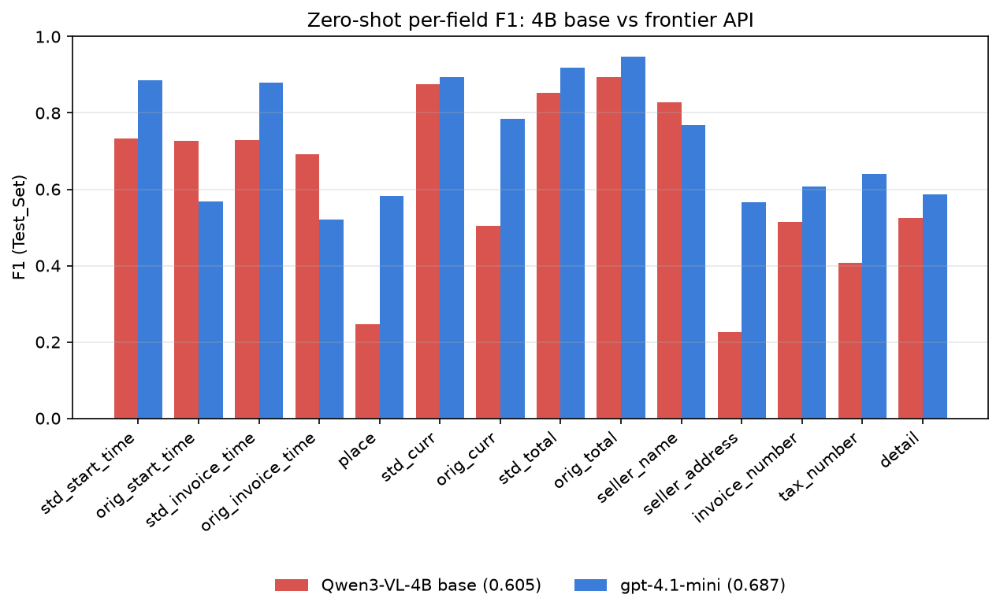

# Zero-shot baseline: Qwen3-VL-4B-Instruct (base)

## Summary

The untuned 4B model scores **overall F1 0.605** (precision 0.563, recall 0.654, 0 parse failures) on the 300 Test_Set receipts at eval batch size 8. That's 0.082 below gpt-4.1-mini (0.687) with the same prompt and scorer. The gap isn't about reading. The 4B model reads printed dates and seller names *better* than the API model. It loses on following the output format: it writes `Carmichael, CA` where the prompt asks for `Country-City`, `RM` where it asks for an ISO code, and it adds summary lines to the item list. Those are exactly the habits supervised fine-tuning teaches cheaply, so this baseline is a promising starting point, not a weak one.

The same model at batch size 1 scored 0.602. No field moved by more than 0.017 F1 between the two settings (see the batching finding). The error counts and examples below come from the batch-1 run; the error patterns are the same at batch 8.

## Per-field comparison

| Field | Base F1 | API F1 | Δ | What drives the difference |
|---|---|---|---|---|
| seller_address | 0.227 | 0.565 | −0.338 | 152 of 275 values aren't `Country-City` (e.g. `Carmichael, CA`) |
| place | 0.246 | 0.582 | −0.336 | only 117 of 266 predictions use `Country-City`; 97 have no country, 52 are `City, State` |
| orig_curr | 0.505 | 0.785 | −0.280 | 46 missing: leaves the list empty when no symbol is printed, though the label holds the city |
| tax_number | 0.407 | 0.641 | −0.234 | 38 hallucinations vs 21; more often picks the wrong number |
| std_start_time | 0.733 | 0.885 | −0.152 | standardises dates wrongly (see below) |
| std_invoice_time | 0.728 | 0.880 | −0.152 | same |
| invoice_number | 0.515 | 0.606 | −0.091 | 52 misreads vs 34, e.g. `CS00004071` → `C500004071` |
| std_total | 0.853 | 0.918 | −0.065 | 28 misreads vs 11 |
| detail | 0.525 | 0.587 | −0.062 | more extra lines: precision 0.455 vs 0.537 |
| orig_total | 0.893 | 0.948 | −0.055 | |
| std_curr | 0.876 | 0.894 | −0.018 | 36 misreads: local codes like `RM`, `RS` instead of `MYR`, `INR`; but only 3 missing vs 32 |
| **seller_name** | **0.828** | 0.768 | **+0.060** | keeps the brand name instead of the legal entity more often |
| **orig_start_time** | **0.727** | 0.569 | **+0.158** | appends the printed time less often |
| **orig_invoice_time** | **0.693** | 0.522 | **+0.171** | same |

## Where the 4B model fails

- **Format, not reading.** `place` and `seller_address` account for most of the gap. The model finds the right city (`Miami Beach`, `Carmichael, CA`, `San Pablo Avenue, El Cerrito, CA`) but ignores the requested `Country-City` shape and the "not the street address" instruction. gpt-4.1-mini follows those instructions, while the 4B model mostly copies what's printed.
- **Its standard dates contradict its own reading of the date.** On 40 receipts, the base model's `std_start_time` doesn't match the date it gave in `orig_start_time`, and the standard date is wrong. Examples: `12/25/2016` → `2020-12-25`, and `2/29/2016` → `2011-08-01`. gpt-4.1-mini does this on 12 receipts. So the small model sees the date correctly but fumbles converting it to `YYYY-MM-DD`: it guesses the year or swaps day and month (12 of 64 misreads). That's a reasoning/consistency weakness, not a vision one.
- **Codes vs symbols.** It writes the printed currency marker (`RM`, `RS`, `C`) where an ISO 4217 code is asked for. On the other hand, it almost never leaves the currency blank (3 vs 32 for the API).
- **Item lists include summaries.** It returns 2,376 lines against 1,782 in the labels. That includes 133 "Subtotal" lines, 94 "Total" and about 30 cash or change lines, which the labels leave out. ifTax is set on only 291 lines vs 483 in the labels, the same tax-inclusive convention gap the API model has.
- **Rare runaway generation.** At batch 1, one receipt (0.3%) produced a valid start and then repeated `0` until it hit the 1,536-token limit, so it couldn't be parsed. At batch 8 the same receipt parsed, because tiny numeric differences sent greedy decoding down a different path. Degenerate repetition is a known small-model failure under greedy decoding. It's rare enough not to matter for the score, but it shows why the output token cap is needed.

## Where it is better

- **Printed dates:** the base model appends the time to `orig_*_time` far less than gpt-4.1-mini. Only 36 of its 71 orig_start_time misreads are "right day, extra time", against 94 of 113 for the API. That's why both orig date fields score about 0.16 higher, even though no prompt change was involved.
- **Seller names:** 0.828 vs 0.768. It tends to output the shop name exactly as printed and doesn't add the legal company name from the footer.

## The two models make different mistakes

Over 4,200 field outcomes (300 receipts × 14 fields, batch-1 run):

| | Count | Share |
|---|---|---|
| both correct | 2,269 | 54% |
| only gpt-4.1-mini correct | 718 | 17% |
| only base correct | 319 | 8% |
| neither correct | 894 | 21% |

On 319 field outcomes (8%), the 4B model is right where the API model is wrong, so it isn't just a weaker copy. And 21% of outcomes defeat both models. Many of those are label conventions or noise (time-less dates, country spelling, empty identifiers, zero totals) that no zero-shot model can match. That share is the main target for fine-tuning.

## Speed and cost on the pod

| Metric | Base, batch 1 | Base, batch 8 | gpt-4.1-mini API |
|---|---|---|---|
| Mean / p90 time per receipt | 22.4 s / 33.4 s | 4.9 s / 6.4 s (throughput) | 3.8 s median / 5.5 s p90 |
| Cost per receipt | $0.0055 | $0.0012 | $0.00097 |
| Full Test_Set | 111 min, $1.65 | 26 min, $0.39 | about 20 min, $0.29 |

All local numbers are on an RTX 4090 at $0.89/h with HF `generate`. At batch 1, greedy decoding generates about 20 tokens/s (median 407 output tokens per receipt) and leaves most of the GPU idle, so self-hosting cost 5.7× the API per receipt. Batching 8 receipts brings that down to 1.25×. At the community-cloud price ($0.34/h) it would be about $0.0005 per receipt, half the API cost. vLLM would be faster again but can't serve LoRA adapters on the vision layers, which this project trains. In self-hosting, the serving setup matters as much as the model.

## Takeaways for fine-tuning

1. **The biggest expected gains are formatting:** `place` and `seller_address` (+0.34 just to reach the API model), `orig_curr`, and dropping summary lines from `detail`. All are visible in every training label, so even 100 examples should move them.
2. **Date standardisation is a real skill gap:** SFT targets always pair a printed date with its correct `YYYY-MM-DD` form, which should teach the conversion. Watch std dates as a sign that the model learns reasoning, not just format.
3. **Keep the base model's strengths:** printed dates and seller names must not regress. If they do, the adapter is overfitting to label noise.
