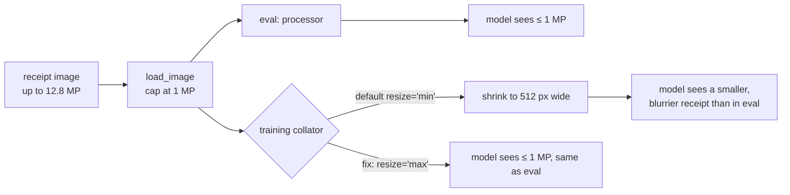

# GPU pod setup and training memory

## Summary

Training and evaluation run on one RunPod RTX 4090 (24 GB) using bf16 LoRA without 4-bit quantisation. The worst-case training step peaks at 10.1 GB, so there is plenty of headroom. Setting up the pod surfaced three problems that would have cost time or quietly hurt results: a cheap host with a broken GPU driver, an install blocked by the OS image, and a default in Unsloth that shrank every training image to 512 px wide.

## Community vs secure cloud

- The community-cloud 4090 ($0.34/h) kept placing the pod on the same machine, and its CUDA driver was broken there. `nvidia-smi` listed the GPU, but CUDA initialisation failed with an unknown error, and PyTorch reported no GPU. It failed the same way on three attempts, so retrying didn't help.
- A secure-cloud 4090 ($0.89/h, high availability) worked on the first try. That's 2.6× the hourly price. The budget tracking uses the real rate, so spend reports stay accurate.
- **Lesson:** run a one-line PyTorch CUDA check right after a pod boots, before copying data or installing anything. `nvidia-smi` working doesn't prove the GPU can be used.

## Environment

- Image: `runpod/pytorch:1.4.0-cu1281-torch2130-ubuntu2404`, which ships torch 2.13.0 (CUDA 12.9 build). That's inside Unsloth's supported range, so torch is never reinstalled.
- Ubuntu 24.04 marks the system Python as externally managed (PEP 668), so a plain `pip install` is refused. The setup script passes `--break-system-packages`. That's acceptable because the container is disposable.
- Packages install onto the container disk, which RunPod wipes whenever the pod stops. Only `/workspace` survives (code, data, model cache, runs), so setup must be rerun after every restart. It takes a few minutes, because the 4B model stays cached on `/workspace`.
- SSH sessions don't inherit the container's `RUNPOD_*` variables. The pod ID exists in the container, but a run started over SSH can't see it, so it decides it isn't on a pod: it logs $0 cost and `--stop-pod` does nothing. Runs therefore start with `. /etc/rp_environment`, the file RunPod provides for exactly this. Without it, the spend tracking would quietly under-report the whole budget.
- Every pinned version installed as pinned. The full 207-package freeze is saved for exact reproduction.

## Hidden image downscaling in training

Unsloth's vision data collator resizes images by default. Qwen3-VL doesn't declare an image size, so the collator falls back to 512 and scales every training image down to 512 px wide. That's on top of the project's own 1-megapixel cap.

Left in place, this would have trained the model on blurrier receipts than it is evaluated on. Small print like tax numbers, invoice numbers and line-item amounts would be harder to read during training, and the fine-tuned scores would come out lower without any error message. The fix is `resize="max"`, which turns off Unsloth's resize so the 1-megapixel cap applies the same way in training and evaluation.

## Memory check

Two training steps on the two hardest receipts: the largest image (12.78 MP, downscaled to the 1 MP cap) and the receipt with the most line items (41, about 900 label tokens).

| Setting | Peak GPU memory | Time per step |
|---|---|---|
| Unsloth default (512 px wide) | 10.00 GB | n/a (first run included compilation) |
| Full 1 MP images | 10.14 GB | about 8 s |

The memory barely moved because about 9 GB of it is the 4.4B-parameter model in bf16. Gradient checkpointing and Unsloth's gradient offloading keep activations near 1 GB even at full resolution. Real training uses batches of 2, which may add a GB or two and still fits in 24 GB. 4-bit loading isn't needed, so the model is trained at full bf16 precision.
