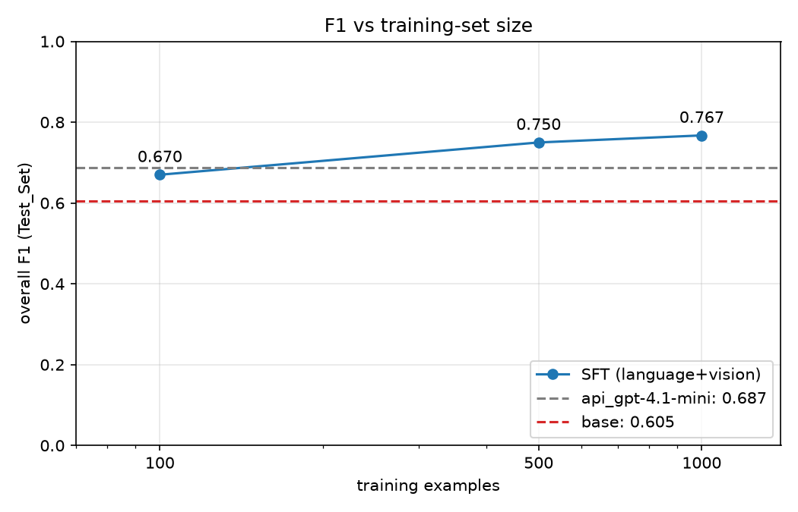
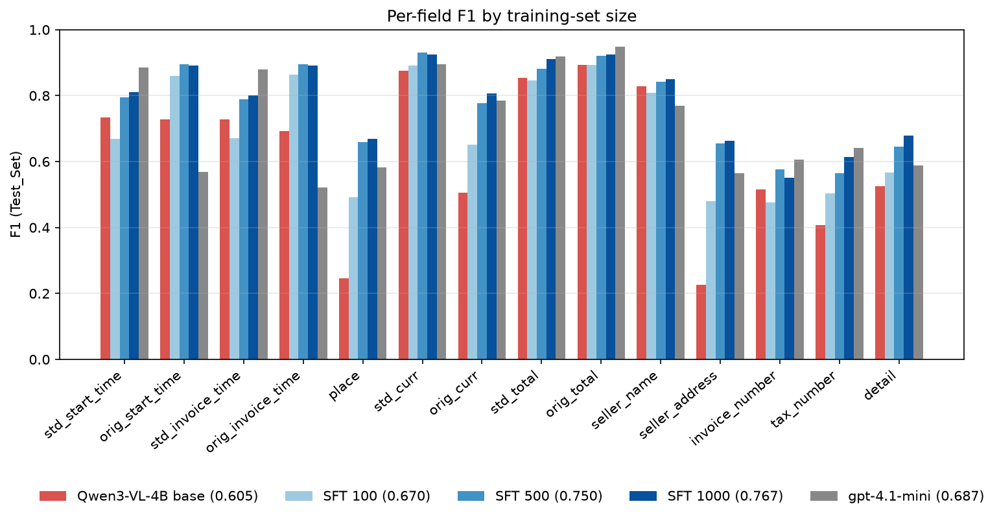
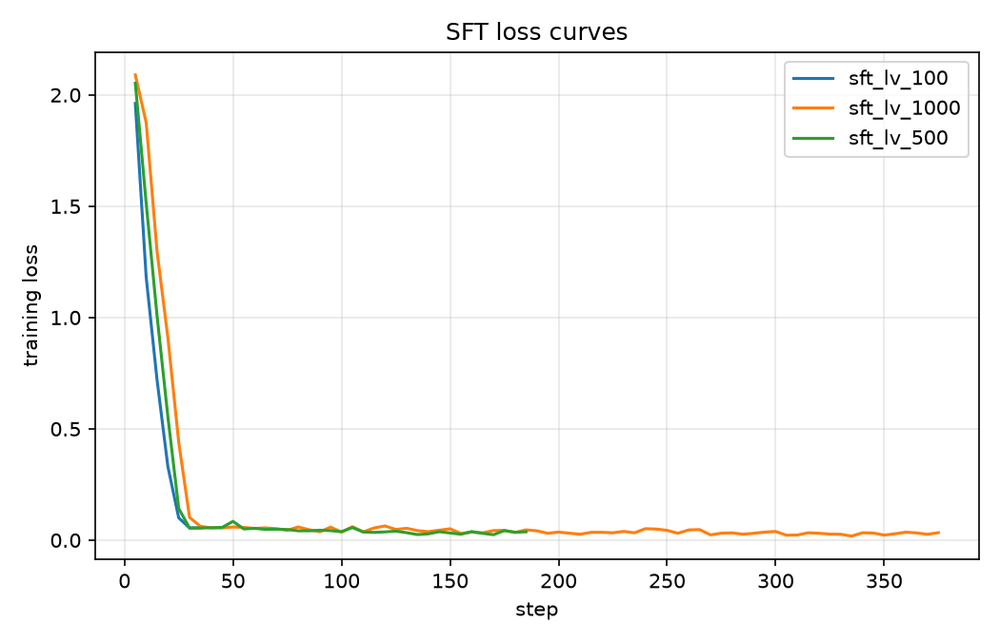

# SFT data-efficiency curve

## Summary

LoRA fine-tuning of Qwen3-VL-4B on the language and vision layers lifts Test_Set overall F1 from **0.605 (base) to 0.670 with 100 examples, 0.750 with 500 and 0.767 with 1,000**. Already at 500 examples the 4B model beats gpt-4.1-mini (0.687) by 0.063, and at 1,000 by 0.080. The curve flattens quickly. Each 100 extra examples was worth about +0.020 F1 between 100 and 500, but only about +0.003 between 500 and 1,000. Most of what SFT teaches here is the label conventions: output format, what to leave out, and how to write places and currencies. Those are learned from a few hundred examples. What remains after that is reading and reasoning errors, which more examples of the same kind fix only slowly.

| Model | Test F1 | Precision | Recall | Val F1 | Parse failures (test) | Training time |
|---|---|---|---|---|---|---|
| base | 0.605 | 0.563 | 0.654 | n/a | 0 | n/a |
| SFT 100 | 0.670 | 0.672 | 0.668 | 0.671 | 8 | 3.5 min |
| SFT 500 | 0.750 | 0.744 | 0.755 | 0.751 | 1 | 12.7 min |
| SFT 1000 | **0.767** | **0.769** | **0.765** | 0.747 | 1 | 24.6 min |
| gpt-4.1-mini | 0.687 | 0.655 | 0.724 | n/a | 0 | n/a |

All runs use the same settings: LoRA r 16 on attention and MLP of both towers (39.3M trainable parameters), 3 epochs, learning rate 2e-4, effective batch 8, seed 3407. The three trainings together cost about $0.60 on an RTX 4090 at $0.89/h.

## Per field

| Field | Base | SFT 100 | SFT 500 | SFT 1000 | API |
|---|---|---|---|---|---|
| place | 0.246 | 0.491 | 0.658 | **0.668** | 0.582 |
| seller_address | 0.227 | 0.479 | 0.654 | **0.664** | 0.565 |
| orig_curr | 0.505 | 0.650 | 0.778 | **0.806** | 0.785 |
| detail | 0.525 | 0.566 | 0.645 | **0.678** | 0.587 |
| orig_start_time | 0.727 | 0.860 | **0.896** | 0.892 | 0.569 |
| orig_invoice_time | 0.693 | 0.865 | **0.896** | 0.892 | 0.522 |
| std_curr | 0.876 | 0.892 | **0.932** | 0.925 | 0.894 |
| seller_name | 0.828 | 0.810 | 0.842 | **0.850** | 0.768 |
| std_total | 0.853 | 0.847 | 0.882 | 0.911 | **0.918** |
| orig_total | 0.893 | 0.894 | 0.921 | 0.926 | **0.948** |
| std_start_time | 0.733 | 0.669 | 0.795 | 0.810 | **0.885** |
| std_invoice_time | 0.728 | 0.671 | 0.790 | 0.801 | **0.880** |
| tax_number | 0.407 | 0.504 | 0.565 | 0.613 | **0.641** |
| invoice_number | 0.515 | 0.475 | 0.577 | 0.551 | **0.606** |

The fine-tuned model now leads on 9 of 14 fields. The API model still leads on standard dates, totals and the two identifier fields.

## What SFT taught

- **The `Country-City` format.** The base model wrote `Country-City` for 111 of 266 places, and the SFT models for 232 of 233 or better. That alone took `place` and `seller_address` from about 0.24 to about 0.66, ahead of the API model, which formats places correctly too but scores 0.58.
- **The label's own spelling habits.** The labels write US locations as `USA` 413 times and `United States` 208 times. The 100-example adapter mostly chose `United States` (83 of 129). At 500 and 1,000 examples it settled on `USA` for about 80% of US receipts, the majority form in the labels. No model can be right on all of them, because the choice in the labels is arbitrary. This label noise caps `place` and `seller_address` well below 1.0.
- **What not to put in `detail`.** The base model listed 2,386 lines against 1,782 in the labels, including 261 subtotal, total, cash or change lines. SFT 1000 lists 1,762 lines against 1,769, with 13 summary-like lines. gpt-4.1-mini still lists 2,150 lines with 159 summary lines. This is the main reason for the jump in overall precision, from 0.563 to 0.769. False positives fell from 2,523 to 1,139, while true positives rose by 550.
- **Printed dates without the time.** `orig_*_time` went from about 0.71 (base) to about 0.89. The API model, which appends the printed time, stays near 0.55.
- **Codes and city for currency.** `std_curr` uses ISO codes, and `orig_curr` now holds the symbol and the city as the labels do.

## What more data improved

Between 100 and 1,000 examples, most of the gain came from fewer errors on harder cases, not from format:

| Error type (sum over fields) | Base | SFT 100 | SFT 500 | SFT 1000 | API |
|---|---|---|---|---|---|
| Missing | 102 | 255 | 110 | 129 | 77 |
| Hallucination | 301 | 232 | 142 | 119 | 233 |
| Misread | 1,200 | 844 | 678 | 632 | 903 |

- **The 100-example adapter gives up and invents.** It leaves fields empty more than twice as often as the base model (255 Missing), partly through the 8 repetition loops, which lose whole receipts. On the 33 test receipts whose labels have no date, it invented a standard date 30 times, against 6 for both the base model and SFT 1000. That's why its standard dates (0.669) score *below* the base model's (0.733), even though its printed dates are much better.
- **Date conversion gets more reliable with data, but stays the main weakness.** Counting only receipts where the model read the printed date exactly as labelled, the standard date was still wrong on 18% for base, 19% for SFT 100, 10% for SFT 500 and 9% for SFT 1000, against 3% for gpt-4.1-mini. Most of SFT 1000's remaining conversion errors are ambiguous numeric dates. `8/01/16` on an Australian receipt means 8 January (label `2016-01-08`), but the model reads it US-style as 1 August. It swaps day and month on 13 test receipts. Getting this right means knowing each country's date order, which the API model applies far better.
- **Hallucinations keep falling** (232 → 142 → 119), mostly on identifiers and dates. More examples of "leave it empty when it isn't printed" make the model less willing to guess.

## Why the curve flattens

From 500 to 1,000 examples, 9 fields improved and 5 stayed flat or dipped slightly (invoice_number 0.577 → 0.551, std_curr, the orig dates). Those dips are within the noise of a 300-receipt test set. The conventions are learned by 500 examples. What remains is reading small print (invoice and tax numbers, a `6` vs `8` in a total) and date-order reasoning. Neither gets easier just because the model sees more receipts with the same label style, so they improve slowly. Larger gains from here would more likely come from training directly on what is scored (GRPO with a rule-based reward), or from higher image resolution for the small print.

## Training loss doesn't tell the sizes apart

All three runs fall from about 2.0 to about 0.05 within the first 30 steps (about 240 examples seen), then stay flat at 0.03–0.06. The 1,000-example run reaches the same low loss before seeing any receipt twice, so a loss of 0.05 is not a sign of memorisation. It's low because most target tokens are easy to predict: JSON keys, punctuation, and values like `false` and `USD`. The few hard tokens, such as digits and dates, barely move the average. So the training loss can't be used to choose between adapters or to detect overfitting here. Only held-out F1 can.

## Val vs test

Val (50 receipts) and test (300) agree within 0.001 for 100 and 500, but they rank 500 and 1,000 differently: 0.751 vs 0.747 on val, 0.750 vs 0.767 on test. A 50-receipt set can't separate two models that are 0.02 apart. Model selection by val F1 is sound in principle, because test results are never used for choices. But at this size it is close to a coin flip between nearby adapters.

## Cost per receipt

Fine-tuning also shortened the outputs, because there are fewer detail lines and no runaway generations. Throughput time per receipt at batch 8 fell from 4.9 s (base) to 4.5 s (SFT 1000), or $0.0011 per receipt at $0.89/h. That's 1.13× gpt-4.1-mini's $0.00097, with 0.080 higher F1. The 100-example adapter is the exception, at 5.6 s mean and 15 s p90, because its loops hold up a whole batch until the timeout.
