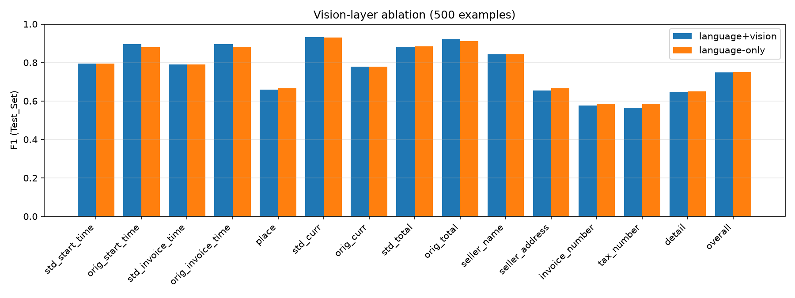

# Vision-layer ablation: LoRA on the vision encoder adds nothing here

## Summary

At 500 training examples, putting LoRA on the language layers only scores the same as putting it on both the language and vision layers: **Test_Set overall F1 0.751 vs 0.750**. All other settings are identical. Per-field differences are all within ±0.022, and the two adapters give the same outcome on 94.3% of the 4,200 field outcomes. Training the vision encoder doesn't help on this task. That fits what the baselines already showed: the base model *reads* receipts well, and its errors come from output conventions and reasoning, which live on the language side. Language-only is also slightly cheaper to train, with 16% fewer trainable parameters (33.0M vs 39.3M) and 14% less time (10.9 vs 12.7 min).

| | language+vision | language-only |
|---|---|---|
| Test F1 | 0.750 | 0.751 |
| Precision / recall | 0.744 / 0.755 | 0.747 / 0.755 |
| Test F1 without the 2 failed receipts | 0.752 | 0.754 |
| Parse failures (test) | 1 | 2 |
| Val F1 (50 receipts) | 0.751 | 0.736 |
| Trainable parameters | 39.3M | 33.0M |
| Training time (500 × 3 epochs) | 12.7 min | 10.9 min |

## Per field

| Field | lang+vision | lang-only | Δ |
|---|---|---|---|
| tax_number | 0.565 | 0.586 | +0.022 |
| seller_address | 0.654 | 0.667 | +0.012 |
| invoice_number | 0.577 | 0.586 | +0.009 |
| place | 0.658 | 0.667 | +0.008 |
| detail | 0.645 | 0.651 | +0.005 |
| std_total | 0.882 | 0.884 | +0.001 |
| std / orig dates, std_curr, orig_curr, seller_name | | | −0.002 to 0.000 |
| orig_total | 0.921 | 0.912 | −0.009 |
| orig_start_time | 0.896 | 0.881 | −0.015 |
| orig_invoice_time | 0.896 | 0.881 | −0.015 |

There's no pattern that points to better reading with the vision layers trained. The fields that depend most on reading small print are `invoice_number`, `tax_number` and the totals, and they are level or slightly *better* without vision LoRA. The small loss on printed dates is 3 receipts with a date left empty, partly from the extra parse failure. Of the field outcomes where the two adapters differ, language+vision is right on 119 and language-only on 101.

## Why the vision encoder doesn't need training

- **The errors are not reading errors.** The base model already beat gpt-4.1-mini on seller names and printed dates. Its losses came from format (`Country-City`, ISO codes, no summary lines) and from date conversion. All of these are decisions about what to write, made after the image has been encoded. LoRA on the language layers can change them. LoRA on the vision layers mostly changes how the image is represented, which was already good enough.
- **Receipts are in-domain for the encoder.** Qwen3-VL's vision encoder was pre-trained on large amounts of document and OCR data. Printed receipt text at up to 1 megapixel is well inside what it already handles. Vision LoRA would matter more for unusual visual domains, such as handwriting, heavy blur, or unfamiliar scripts.
- **The remaining reading errors are resolution limits.** Misread digits in invoice numbers come from small, low-contrast print. A rank-16 adapter on the encoder can't recover detail the image doesn't contain at the chosen pixel budget. Higher resolution would be the lever, not more trainable vision weights.

## Val vs test again

Val ranks language+vision clearly ahead (0.751 vs 0.736), while test shows a tie. A 0.015 val gap on 50 receipts is noise; it comes to a handful of field outcomes. This is the second time in this project that val has ordered two adapters differently from test. Val-based selection keeps the test set clean, but at this size it only separates models that differ a lot.

## What this means in practice

For receipt extraction with a modern VLM, language-only LoRA is the better default. It gives the same accuracy for less memory and training time, and the adapter is smaller to store and serve. It's also easier to deploy: vLLM can serve LoRA adapters on the language layers but not on the vision tower. So a language-only adapter can run on a fast batched server without merging weights.
